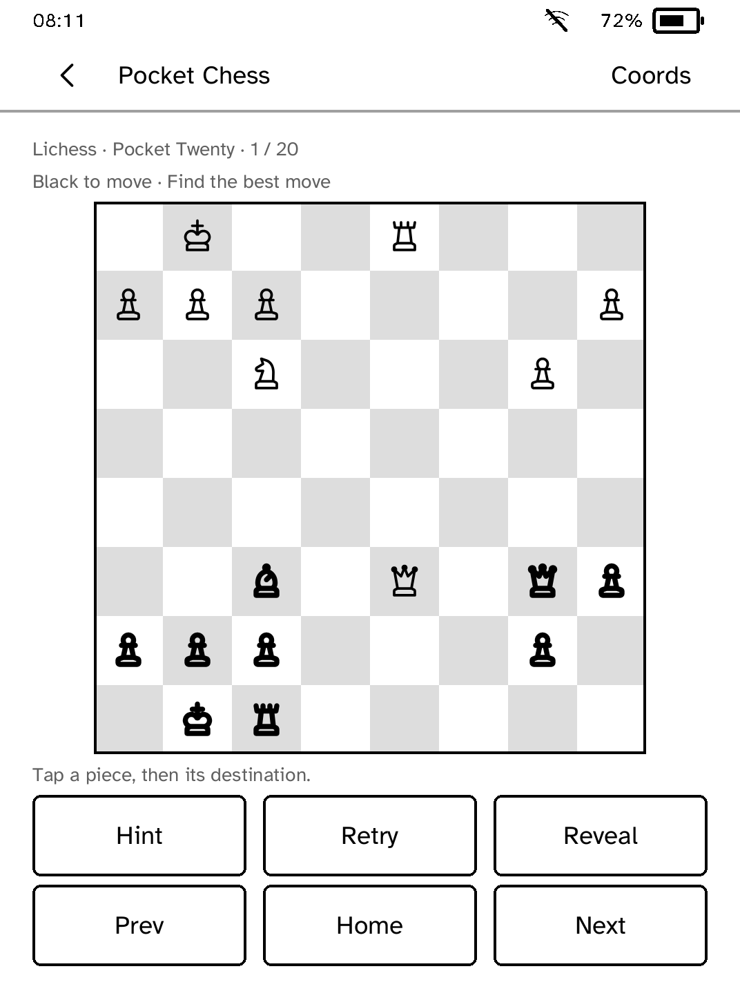
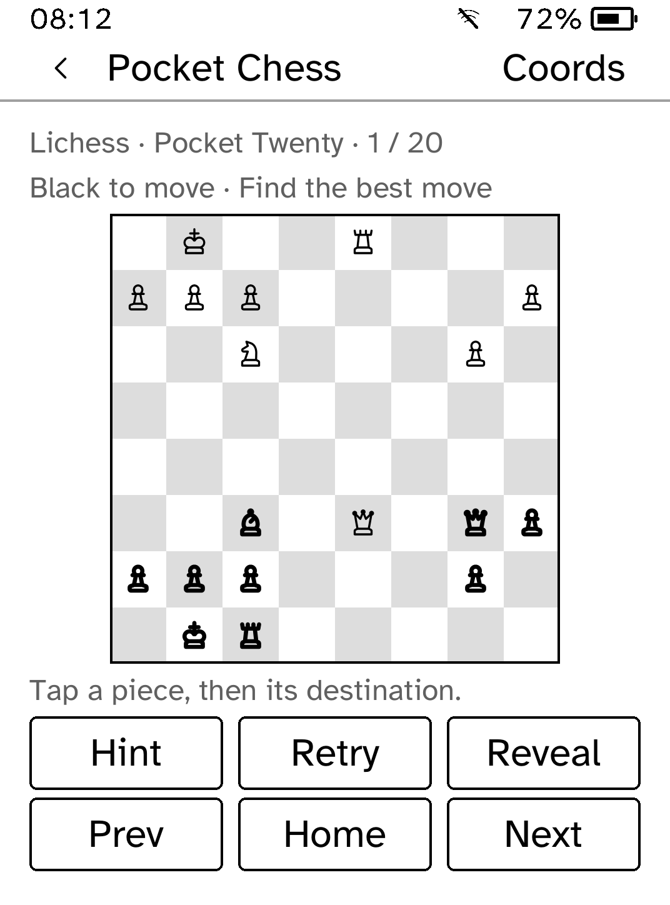
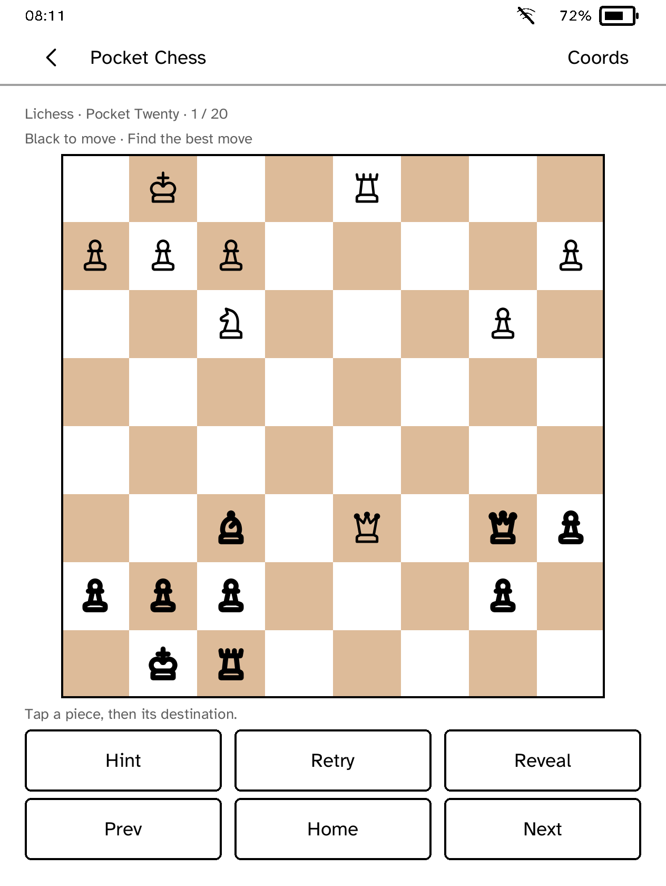
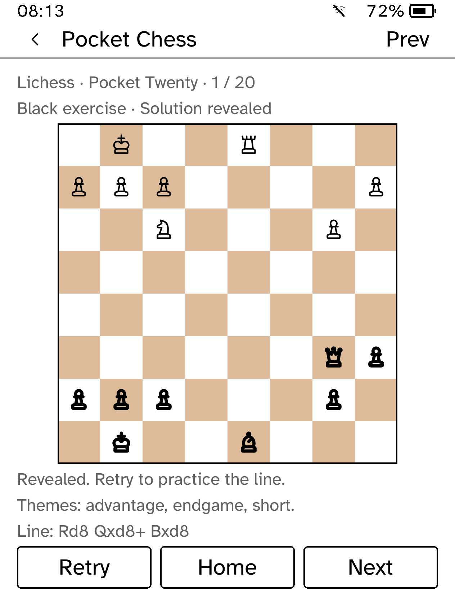

# Pocket Chess Studies

An offline chess puzzle book for Cobalt, version **0.2.0**. The initial
**demonstration collection contains twenty CC0 Lichess puzzles**. No Polgár book
library, private trainer database, user history or account credential is included.
This is an independent application; no author/publisher endorsement is claimed.

## Study

Select the installed collection and Continue. Tap a piece and destination; the
app checks full standard-chess legality, plays the supplied opponent reply and
accepts the ordered solution. Hint marks only the source. Retry starts a fresh
attempt while retaining history; Reveal shows SAN and never records a solve.
Previous/Next also use physical page buttons, with confirmation during an active
attempt. Home/Continue retains that attempt. Exit waits for acknowledged saves;
storage errors offer explicit recovery or loss acknowledgement.

The brown/paper board and filled black/outlined white pieces use Cobalt's own
renderer. No custom fonts, SVG set or raster icon are bundled. The launcher mark
is Cobalt's built-in **book** glyph, distinct from Lichess's knight. Interface
text follows Cobalt Settings. The root-level board reserves controls below it
at normal and 170% text scaling.

## Permissions and compatibility

No capabilities, accounts, Wi-Fi hold, polling timer, engine or background task.
Local snapshots use Cobalt's atomic app store. The target is Kobo Libra Colour
(N428/code 390); Clara BW simulation is also checked for contributor review.
Cobalt 0.3.37 or newer is the explicit compatibility floor. Physical colour,
button mapping, power/suspend behavior and coexistence with Zen OS, KOReader,
NickelMenu and Focus Reader remain unverified; no device installation occurred.
Do not treat this review branch or its fixture signature as an installed release.

## Actual simulator captures

<table>
<tr><td><br>Clara BW simulator, normal text</td><td><br>Clara BW simulator, 170% text</td></tr>
<tr><td><br>Libra Colour simulator, normal text</td><td><br>Libra Colour simulator, 170% text</td></tr>
</table>

Screenshots in `screenshots/` are unedited output of `kobo drive --ideal`, using
fresh temporary state and only public CC0 puzzles. They are not device photos.
CAPTURES.json records profile, text size, SHA-256 and scenario. The website gallery
has the same authentic files and explicit simulator captions.

## Content and code licenses

Application: AGPL-3.0-only, including its SDK-linked code. See LICENSE and
THIRD-PARTY.md. Standard chess: shakmaty 0.27.3, GPL-3.0-or-later. Serialization:
serde/serde_json, MIT OR Apache-2.0. These are existing workspace libraries;
this contribution does not downgrade or replace them. Cobalt supplies its own
licensed vector art and fonts; none are copied from a private trainer or Cburnett.

The twenty puzzle records are CC0-1.0 from Lichess's public database. Original
IDs, FENs, source rows, ratings and moves are preserved in `packs/`. The published
setup move is applied exactly once before study. `packs/SOURCE.md` identifies
the exact public mirror revision and subset hash. Theme labels are not book
annotations. Legality and execution are tested; no new engine uniqueness claim
is made. The product name remains subject to owner/maintainer naming review.
"Pocket Chess Studies" is a proposed alternative before publication; retaining
the internal `polgar-pocket` identity would preserve the existing progress key.

## Development

From Cobalt root, with its pinned compiler/cross tools:

```bash
cargo +1.85.1 test --locked -p kobo-polgar-pocket
cargo +1.85.1 clippy --locked -p kobo-polgar-pocket --all-targets --all-features -- -D warnings
cargo +1.85.1 build --locked -p kobo-polgar-pocket
cargo +1.85.1 build --locked --release --target armv7-unknown-linux-musleabihf -p kobo-polgar-pocket
node tools/app-contribute.mjs --manifest apps/polgar-pocket/cobalt-app.json --dry-run
```

`drive.kobo` is a short real-input smoke script. The independent application
repository supplies full all-puzzle/restart/recovery simulator suites, configured
to run this exact Beta workspace app. Its submission report records their results.
This proposed source contribution has not been submitted, signed with the
maintainer release key, published or installed on a reader.
